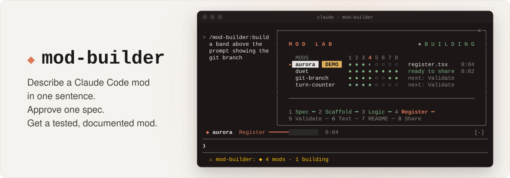
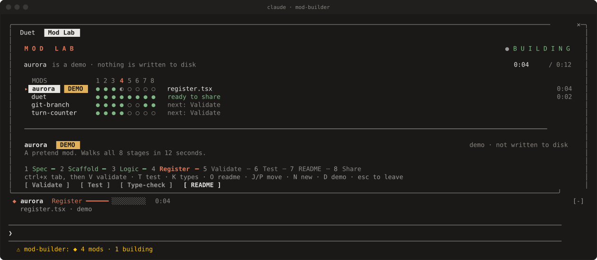
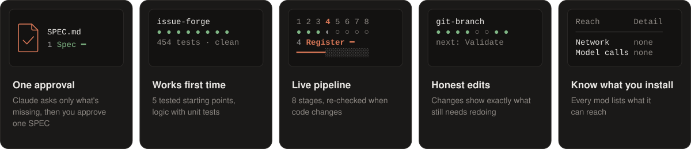

<p align="center">
  <picture>
    <source media="(prefers-color-scheme: dark)" srcset="docs/assets/hero-dark.svg">
    <source media="(prefers-color-scheme: light)" srcset="docs/assets/hero-light.svg">
    
  </picture>
</p>

<p align="center">
  <b>Describe a Claude Code mod in one sentence. Approve one spec. Get a tested, documented mod.</b>
</p>

<p align="center">
  
  
  <a href="https://github.com/bankielewicz/mod-builder/actions/workflows/ci.yml"></a>
  <a href="LICENSE"></a>
</p>

## Why

**Mods** are the most powerful way to extend Claude Code. A mod can draw panes and bands, add
slash commands, guard risky tool calls, and react to everything Claude does. But the API is early
access, mods run unsandboxed, and the engine has rules you only learn by breaking them.

**mod-builder** turns that into a conversation. You say what you want, approve a one-page SPEC,
and Claude builds the mod: logic with unit tests, validated, type-checked, documented, and
installable. **Mod Lab** shows every stage pass, live, inside Claude Code.

<p align="center">
  
</p>

## Quick start

```text
/plugin marketplace add bankielewicz/mod-builder
/plugin install mod-builder@claudemod
```

Choose **User** scope when asked, so it works in every project. Then:

```text
/modlab demo                                                     # watch a mod build itself (12 s, nothing saved)
/mod-builder:build a band above the prompt showing the git branch
/mod-builder:edit git-branch also show unpushed commits          # change it later, the same way
```

## What you get

<p align="center">
  
</p>

- **One approval, not a hundred.** Claude asks only what your request leaves open, then writes a
  SPEC listing every file, process and cost. You approve once.
- **Mods that work the first time.** Five tested starting points (band, pane, guard, watcher,
  command). Logic is written first, with tests, and every mod passes `validate`, `test` and `tsc`
  before handoff.
- **A live build pipeline.** Mod Lab tracks each mod through 8 stages, re-runs checks when code
  changes, and puts a **Fix with Claude** button on any failure.
- **Changes that stay honest.** `/mod-builder:edit` appends to the SPEC, bumps the version, and
  shows exactly which stages the change still needs.
- **Know what you install.** Every mod's README says what it can reach: processes, files,
  network, model calls.

## Built with mod-builder

Each of these was built by `/mod-builder:build` (and ensemble, formerly duet, extended with `/mod-builder:edit`).
git-branch, ensemble and issue-forge are in this marketplace, so you can install one and try its demo;
turn-counter loads from its folder.

| Mod | What it does | Try it |
|---|---|---|
| [**git-branch**](mods/git-branch/) | A band above the prompt with the current branch, changed files, and ahead/behind | `/plugin install git-branch@claudemod`, then `/git-branch demo` |
| [**ensemble**](mods/ensemble/) (formerly duet) | Hands chosen subagents to OpenAI's Codex, gets independent Codex reviews of your diff, and measures every run. Needs the [Codex CLI](https://github.com/openai/codex). | `/plugin install ensemble@claudemod`, then `/ensemble demo` |
| [**issue-forge**](mods/issue-forge/) | Takes a GitHub issue to a pull request, test-first: red, green and refactor subagents, with commands and a 95% diff-coverage gate checking each phase. Pushes only after you say yes. Needs `gh` signed in and a `.issue-forge.json` profile in the repository. | `/plugin install issue-forge@claudemod`, then `/issue-forge demo` |
| [**turn-counter**](mods/turn-counter/) | Counts this turn's tool calls in a band. Left as the scaffold produced it, mid-pipeline, so you can see a mod before its README and Share stages. | `claude --plugin-dir mods/turn-counter`, then `/turn-counter demo` |

Read each mod's **What it reaches** table before installing it.

> [!WARNING]
> Mods are not sandboxed: they run with your access and skip Claude's permission prompts. Read a
> mod's "What it reaches" table before installing it. [More on safety](docs/safety.md).

## Docs

| Guide | For |
|---|---|
| [Use it in your own project](docs/use-in-your-project.md) | Building, loading and sharing mods in any repo |
| [Mod Lab](docs/mod-lab.md) | The pane, stages, keys, options, auto re-run and edits |
| [The archetypes](docs/archetypes.md) | The five starting points and when to pick each |
| [How it works](docs/how-it-works.md) | The skills' steps, and the engine rules behind them |
| [Troubleshooting](docs/troubleshooting.md) | Common problems and fixes |
| [Plugin reference](plugins/mod-builder/README.md) | Options, commands, and what Mod Lab reaches |
| [Contributing](CONTRIBUTING.md) | Developing mod-builder itself |

## Requirements

- Claude Code. CI tests every plugin on **2.1.296**; ensemble's and issue-forge's latest changes were
  also checked on 2.1.300. The mod API is early access and changes between builds.
- `node` and `npx`, for the scaffold script and the optional type-check.
- Tested on Linux (WSL2). macOS and Windows native aren't verified yet.

## License

[MIT](LICENSE). Ideas were learned from public mod collections, named in
[NOTICE.md](plugins/mod-builder/NOTICE.md). No code was copied.
