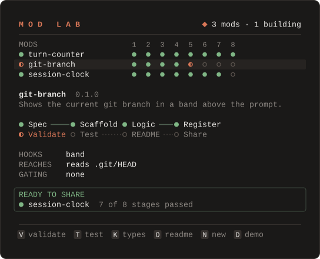

<p align="center">
  <picture>
    <source media="(prefers-color-scheme: dark)" srcset="docs/assets/hero-dark.svg">
    <source media="(prefers-color-scheme: light)" srcset="docs/assets/hero-light.svg">
    
  </picture>
</p>

<p align="center">
  <b>Build Claude Code mods spec-first, then watch every stage pass in Mod Lab.</b>
</p>

<p align="center">
  
  
  
  <a href="LICENSE"></a>
</p>

<p align="center">
  <a href="#quick-start">Quick start</a> ·
  <a href="#build-a-mod-in-your-own-project">Use it in your project</a> ·
  <a href="#the-archetypes">Archetypes</a> ·
  <a href="#mod-lab-tour">Mod Lab</a> ·
  <a href="#troubleshooting">Troubleshooting</a> ·
  <a href="#safety-and-trust">Safety</a>
</p>

<br>

Describe a mod in one sentence. mod-builder asks only what your request leaves open, writes a SPEC
for you to approve, then scaffolds, builds, tests and validates the mod. Mod Lab, itself a mod,
shows every stage as it runs.

## What is a Claude Code mod?

A mod is a Claude Code plugin whose behavior lives in a TypeScript hooks module. It runs inside
Claude Code, where it can draw panes, bands above the prompt, status lines and toasts, add slash
commands, register tools the model can call, and hook tool calls and prompts. The function-hook API
behind mods is in early access, and everything in this repo was built and verified on Claude Code
2.1.296.

> [!WARNING]
> **Mods are not sandboxed.** A mod runs with your full user access and skips Claude's permission
> prompts. Read a mod's code, or at least its "What it reaches" table, before you install it. See
> [Safety and trust](#safety-and-trust).

## What's inside

This repo is a Claude Code plugin marketplace named `claudemod`. It holds one plugin,
`mod-builder`, which has two halves.

<table>
<tr>
<td width="50%" valign="top">

### `/mod-builder:build <idea>`

A skill that builds a mod spec-first.

- Asks only what your request leaves open. A detailed request gets zero questions.
- Writes `SPEC.md`, the single approval gate. It lists every file, process and cost.
- Scaffolds from one of 5 tested archetypes.
- Writes the logic as pure functions with unit tests, then a thin `register.tsx`.
- Verifies with `claude plugin validate`, `claude plugin test`, `tsc` and a headless smoke test.
- Ships a README with a "What it reaches" table, plus a marketplace entry.

</td>
<td width="50%" valign="top">

### Mod Lab · `/modlab`

A showcase mod that uses every surface a mod can draw on.

- Tracks every mod in your mods folder through 8 stages, from Spec to Share.
- A docked pane with stage lights, details, and **[F] Fix with Claude** on errors.
- A band above the prompt that fills on real test progress.
- A status line badge, toasts and a native OS notification.
- `/modlab demo` walks a pretend mod through all 8 stages in 12 s.
- 39 deterministic unit tests, covering logic and UI mounted on terminal, desktop and mobile.

</td>
</tr>
</table>

## Quick start

**1. Install**

```text
/plugin marketplace add bankielewicz/mod-builder
/plugin install mod-builder@claudemod
```

When the install asks for a scope, choose **User** so mod-builder is available in every project.

<details>
<summary>Other ways to install</summary>

<br>

In one line:

```text
/plugin install mod-builder --marketplace bankielewicz/mod-builder
```

From a local clone. In your shell:

```sh
git clone https://github.com/bankielewicz/mod-builder
claude plugin marketplace add ./mod-builder
```

Then in Claude Code:

```text
/plugin install mod-builder@claudemod
```

To try it without installing, start a session with the plugin loaded from the clone:

```sh
claude --plugin-dir mod-builder/plugins/mod-builder
```

</details>

**2. Watch the demo**

```text
/modlab demo
```

A pretend mod, `aurora`, walks all 8 stages in 12 seconds, including one failed test that Claude
fixes. Nothing is written to disk.

**3. Build your first mod**

```text
/mod-builder:build a band above the prompt showing the current git branch
```

Read the SPEC, approve it, and Claude does the rest.

## Build a mod in your own project

You don't need to work inside this repo. Install mod-builder once and use it in any project.

1. **Install mod-builder at user scope.** Use the [install commands](#quick-start) above and
   choose **User** when asked for a scope.

2. **Run the skill in your project.**

   ```text
   /mod-builder:build <idea>
   ```

   The skill looks upward from your working directory for a `.claude-plugin/marketplace.json`. If
   there isn't one, it asks where your mods should live and offers to create a folder
   marketplace there. The usual layout is:

   ```text
   <project>/
     .claude-plugin/marketplace.json   your project's marketplace
     mods/<name>/                      one folder per mod
   ```

3. **Approve the SPEC.** `mods/<name>/SPEC.md` lists every file, process and cost. Once you
   approve it, Claude scaffolds, builds, tests and validates the mod, then fills in the README and
   adds the marketplace entry.

4. **Load your mod.** While you develop, start a session with it loaded. The folder is watched, so
   edits reload on their own:

   ```sh
   claude --plugin-dir mods/<name>
   ```

   Or install it from your project's marketplace. In your shell:

   ```sh
   claude plugin marketplace add .
   ```

   Then in Claude Code:

   ```text
   /plugin install <name>@<your-marketplace>
   ```

   After that, `/reload-plugins` picks up your edits. `/reload-plugins` alone never loads a plugin
   that isn't installed yet.

5. **Point Mod Lab at your mods.** Mod Lab looks for mods in its **Mods folder** option
   (`modsDir`). It is empty by default, which means "the `mods/` folder next to the plugin's own
   marketplace". That fits a clone of this repo, but not your project. Set it to your project's
   `mods/` folder, either on the options screen when you install mod-builder or later in
   `/config`. Then `/modlab` shows your mods.

6. **Add the ignore line.** Claude Code writes type declarations into each mod when it loads it.
   Keep them out of git:

   ```text
   **/.claude-plugin/types/
   ```

7. **Share it.** Commit the folder. Teammates run the two install lines against your repo:

   ```text
   /plugin marketplace add <owner>/<repo>
   /plugin install <name>@<your-marketplace>
   ```

8. **Optional: add CI.** Copy
   [`plugins/mod-builder/skills/build/ci/ci.yml`](plugins/mod-builder/skills/build/ci/ci.yml) into
   your project's `.github/workflows/`. On every push to `main` and every pull request, it
   validates your marketplace, then validates and tests every plugin under `plugins/` and `mods/`.

## The archetypes

Every mod starts from one of five tested archetypes. Each is a small working mod with its own
logic, unit tests, a UI test and a state contract. CI regenerates all five and runs their tests,
so the templates stay buildable.

| Archetype | Use it when | What it draws |
|---|---|---|
| `band` | You want a glanceable line above the prompt. | A band above the prompt that hides when idle and steps aside for surveys. The template counts the current turn's tool calls. |
| `pane-command` | A slash command should open a live view. | A docked pane opened by its command, with buttons and hotkeys. The template is a selectable checklist. |
| `guard` | You want to block or confirm a tool call before it runs. | An "Allow once / Deny" dialog. The template holds risky shell commands (such as `rm -rf` or a force push) until you answer, and refuses them if the check itself fails. |
| `watcher` | You want to react to what happens without blocking anything. | A status line count, a toast and a native notification. The template counts turns and tool calls and flags slow turns. |
| `command-only` | Text answers are enough. | Nothing on screen beyond the command's reply. The template keeps notes that outlive the session. |

A mod that needs more than one archetype starts from its main one, and the SPEC names the hooks
added by hand. [`mods/turn-counter/`](mods/turn-counter/) is an example mod produced by the
scaffold.

## Mod Lab tour

Run `/modlab` to open Mod Lab. It tracks every mod in your mods folder through eight stages, and
judges each stage from the files on disk and the exit codes of real runs.

<p align="center">
  
</p>

| Stage | Passes when |
|---|---|
| Spec | `SPEC.md` exists with no `<placeholder>` left |
| Scaffold | `plugin.json` and `hooks/hooks.json` exist |
| Logic | a logic module and at least one `*.test.ts` exist |
| Register | `hooks/register.tsx` exists |
| Validate | the last `claude plugin validate` passed, and no code has changed since |
| Test | the last `claude plugin test` passed, and no code has changed since |
| README | `README.md` has a "What it reaches" section and no template comments left |
| Share | the marketplace lists the mod |

An illustration of the pane, with one mod mid-Validate:

<p align="center">
  
</p>

| Surface | What Mod Lab does with it |
|---|---|
| Docked pane | Stage lights per mod; a detail panel (version, description, pipeline track, HOOKS, REACHES, gating hooks); an error box with **[F] Fix with Claude**; a "ready to share" box. |
| Band above the prompt | Each running stage, with a 15-cell bar that fills on **real** progress. It streams `claude plugin test` output, which arrives one test file at a time. |
| Status line badge | `◆ 3 mods · 1 building` |
| Toasts and a native OS notification | When runs finish, and when a mod is ready to share. |
| Hotkey buttons | See below. |
| Pre-filled prompts | For a new mod, and for a fix request that quotes the first failure. |
| A model-callable tool, `lab_report` | The skill reports each stage as it works, so the pane lights up live. The disk and exit codes always decide pass or fail. |
| `/modlab demo` | A pretend mod, `aurora`, walks all 8 stages in 12 s, including one failed test that Claude fixes. Nothing is written to disk. |

<details>
<summary>Commands, keys and options</summary>

<br>

**Commands**

| Command | What it does |
|---|---|
| `/modlab` | Opens the pane; run it again to fold the pane to the status line badge. |
| `/modlab demo` | Plays the demo. |
| `/modlab <mod>` | Opens the pane on that mod. |
| `/modlab new <idea>` | Puts `/mod-builder:build <idea>` in the prompt box for you to send. |

**Keys.** The pane's buttons answer to keys once the pane has the keyboard. Press
<kbd>ctrl</kbd>+<kbd>x</kbd> <kbd>tab</kbd> to give it the keyboard (press it again, or
<kbd>esc</kbd>, to hand it back). A dim line above the buttons repeats this.

| Key | Action |
|---|---|
| <kbd>V</kbd> | Run `claude plugin validate` on the selected mod |
| <kbd>T</kbd> | Run `claude plugin test` |
| <kbd>K</kbd> | Run `tsc` (needs the mod loaded once in a session, see [Troubleshooting](#troubleshooting)) |
| <kbd>O</kbd> | Show the mod's README in the pane; <kbd>B</kbd> goes back |
| <kbd>J</kbd> / <kbd>P</kbd> | Select the next or previous mod (or README, in the README view) |
| <kbd>N</kbd> | Put `/mod-builder:build ` in the prompt box |
| <kbd>D</kbd> | Start the demo; press again to stop it |
| <kbd>F</kbd> | Fix with Claude: put a fix request quoting the first failure in the prompt box |

**Options** (set when you install, or in `/config`)

| Option | Default | What it does |
|---|---|---|
| Mods folder (`modsDir`) | empty: the `mods/` folder next to the plugin's marketplace | The folder whose child folders Mod Lab tracks. Set it to your project's `mods/`. |
| Open Mod Lab when a build starts (`autoOpen`) | off | Opens the pane when the skill reports a running stage, if the window is at least 144 columns wide. |

</details>

Mod Lab's rules are deterministic and unit-tested: 39 tests, covering the logic and the UI
mounted on terminal, desktop and mobile.

## How the skill works

`/mod-builder:build` runs five steps around one approval gate.

<p align="center">
  
</p>

| Step | What happens | What it produces |
|---|---|---|
| 1. Interview | Asks only about what your request leaves open, in one batch of up to four questions. A detailed request gets zero questions. | Nothing on disk; the answers go into the SPEC. |
| Gate: SPEC | Lists every file, process and cost. This is the only point where you approve. | `mods/<name>/SPEC.md` |
| 2. Scaffold | Runs the scaffold script with one of the 5 tested archetypes. It never overwrites an existing mod. | The mod folder, with tests that pass as generated. |
| 3. Build | Logic first, as pure functions with unit tests, then a thin `register.tsx`, a state contract and UI tests. | Logic, tests, `register.tsx`, `types/index.d.ts` |
| 4. Verify | Runs `claude plugin validate`, `claude plugin test`, `tsc` and a headless smoke test (`claude -p --plugin-dir mods/<name> "/<name> demo"`). | Pass or fail, from exit codes. |
| 5. Ship | Fills the README, with a "What it reaches" table generated from validate's output, adds the marketplace entry, and tells you how to load the mod. | `README.md`, a marketplace entry |

The skill builds on Claude Code's built-in `plugin-authoring` skill for the API. On top of it,
mod-builder adds house conventions, a UI-state checklist, 14 patterns, and
[a gotchas list](plugins/mod-builder/skills/build/references/gotchas.md) of 43 engine rules. Each
rule is tagged by how it was verified: `[d.ts]` from the API declarations, `[probe]` measured live,
or `[field]` observed in use.

## Troubleshooting

| Symptom | Cause and fix |
|---|---|
| Mod Lab shows "No mods yet" in your project | Its Mods folder option still points at the default. Set `modsDir` to your project's `mods/` (see [step 5](#build-a-mod-in-your-own-project)). |
| Pressing <kbd>V</kbd> or <kbd>T</kbd> types into the prompt | The pane doesn't have the keyboard. Press <kbd>ctrl</kbd>+<kbd>x</kbd> <kbd>tab</kbd> first. Focus returns to the prompt after a reload. |
| The pane doesn't appear | The window is too narrow. A pane you open places at any width, but one that opens by itself waits for 144 columns. Below 34 columns Mod Lab draws nothing and says so in a toast. |
| <kbd>K</kbd> says type-check needs the engine's types | Claude Code writes `.claude-plugin/types/` into a mod only when an interactive session loads it. Load the mod once (`claude --plugin-dir mods/<name>`), then press <kbd>K</kbd>. |
| A mod you just added doesn't load after `/reload-plugins` | `/reload-plugins` re-reads installed plugins only. Install the mod once with `/plugin install <name>@<marketplace>`, or use `--plugin-dir`. |
| A hook seems to do nothing | Start Claude Code with `--debug`. Every hook that fails or returns a tree that doesn't validate gets a line there. |

## Safety and trust

Mods are not sandboxed. A mod runs with your full user access and skips Claude's permission
prompts.

This repo follows two rules:

- **Our own code only.** Community mods are read for ideas. They are never installed or copied.
- **Every mod says what it reaches.** Each mod README carries a "What it reaches" table, generated
  from `claude plugin validate` output, so you can see what a mod touches before you install it.
  Mod Lab's own table is in [its README](plugins/mod-builder/README.md#what-it-reaches).

## Requirements and status

- **Claude Code 2.1.296.** Everything here was built and verified on this version.
- **Early-access API.** Function hooks are in early access, so mods may need changes as the API
  evolves.
- **`node` and `npx`**, for the scaffold script and the optional type-check. The first type-check
  downloads TypeScript through `npx`.
- **Platforms.** Tested on Linux (WSL2). macOS and Windows native are not yet verified.

<details>
<summary>Repo layout</summary>

<br>

```text
.claude-plugin/marketplace.json     the "claudemod" folder marketplace
plugins/mod-builder/                the plugin: skill + Mod Lab
  skills/build/                     SKILL.md, templates/, references/, scripts/, ci/
  hooks/register.tsx                Mod Lab: every $ call
  hooks/mod-builder-logic.ts        Mod Lab: every rule, $-free, unit-tested
  tests/  types/  SPEC.md  README.md  NOTICE.md  design/
mods/turn-counter/                  an example mod the skill's scaffold produced
docs/assets/                        the images in this README
.github/workflows/ci.yml            validate + test every plugin, regenerate every archetype
```

</details>

## Contributing

Load the plugin from your clone while you work:

```sh
claude --plugin-dir plugins/mod-builder
```

Before you open a pull request, run validate, test and the archetype check:

```sh
claude plugin validate .
claude plugin validate plugins/mod-builder
claude plugin test plugins/mod-builder
bash plugins/mod-builder/skills/build/scripts/check-archetypes.sh
```

CI runs the same checks on every push to `main` and every pull request.

New engine findings go in
[`gotchas.md`](plugins/mod-builder/skills/build/references/gotchas.md), with a source tag:
`[d.ts]`, `[probe]` or `[field]`. Only add what you have verified.

## Credits and license

mod-builder is released under the [MIT License](LICENSE).

Ideas were learned from public mod collections, which are named in
[NOTICE.md](plugins/mod-builder/NOTICE.md). No code was copied. The Anthropic API declarations are
referenced, not shipped.
