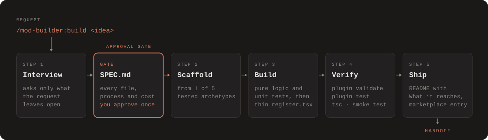

# How it works

[← README](../README.md)

`/mod-builder:build` runs five steps around one approval gate:

| Step | What happens | What it produces |
|---|---|---|
| 1. Interview | Asks only what your request leaves open, in one batch of up to four questions. A detailed request gets none. | Nothing on disk; the answers go into the SPEC |
| Gate: SPEC | Lists every file, process and cost. The only point where you approve. | `mods/<name>/SPEC.md` |
| 2. Scaffold | Generates the mod from one of the 5 archetypes. Never overwrites an existing mod. Its manifest takes the license your repository's `LICENSE` names; with no such file, the interview asks, and a mod with no answer gets no license field. | A mod whose tests pass as generated |
| 3. Build | Logic first, as pure functions with unit tests, then a thin `register.tsx`, a state contract and UI tests | The mod's code and tests |
| 4. Verify | `claude plugin validate`, `claude plugin test`, `tsc`, and a headless smoke test | Pass or fail, from exit codes |
| 5. Ship | README with a "What it reaches" table from validate's output, a marketplace entry, a handoff | `README.md`, marketplace entry |

`/mod-builder:edit <mod> <change>` runs the same steps for an existing mod: it appends a dated
change to the SPEC (one approval), bumps the version by semver, changes logic first, re-verifies and
re-ships. It doesn't re-scaffold. It changes mods in the marketplace's `mods/` folder only: given a
plugin the marketplace lists elsewhere, such as mod-builder itself, it stops and says that a plugin
is changed by Anthropic's plugin documentation instead.

## What the skills know

Both skills build on Claude Code's built-in `plugin-authoring` skill for the API, and add:

- **House conventions** that settle every choice the public mods disagree on.
- **A UI-state checklist:** empty, idle, live, done, error, folded, too narrow, survey, focus.
- **14 patterns**, each pointing at a public mod to read for the idea.
- **[65 engine gotchas](../plugins/mod-builder/skills/build/references/gotchas.md)**, each tagged
  by how it was verified: `[d.ts]` from the API declarations, `[probe]` measured live, or
  `[field]` reported by mod authors.
