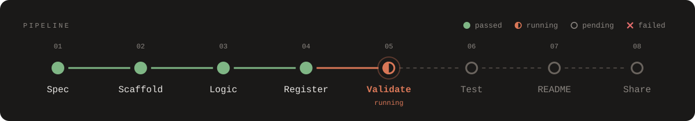

# Mod Lab

[← README](../README.md)

`/modlab` opens a pane that tracks every mod in your mods folder through eight stages, judged from
the files on disk and the exit codes of real runs. The skills report each stage as they work, so
the pane lights up live.

## Reading the pane

- **Header row:** `MODS` over the names, a stage number over each light. The number over the
  selected mod's failed (red), running (coral) or stale (gold) stage lights up. The track in the
  detail panel repeats the numbers beside each stage name.
- **Lights:**

  | Light | Meaning |
  |---|---|
  | `●` | passed |
  | `◐` | running |
  | `✕` | failed |
  | `○` | not done yet |
  | `◌` | stale: it passed, but the code changed afterwards, or an edit started |

- **Status and time** follow a run as it streams (`running tests · 7 of 12`).
- **The selection follows the active build.** <kbd>J</kbd>/<kbd>P</kbd> still move it.
- **A mod appears as soon as a build reports it,** before its folder exists. Until the folder is written its row shows the reported stage running and `folder not written yet`, with no Validate, Test, Type-check or README buttons, and counts as building; the next scan that finds the folder replaces it.

## The eight stages

| # | Stage | Passes when | During an edit, re-passes when |
|---|---|---|---|
| 1 | Spec | `SPEC.md` has no `<placeholder>` left | `SPEC.md` is saved again |
| 2 | Scaffold | `plugin.json` and `hooks/hooks.json` exist | stays green |
| 3 | Logic | a logic module and a `*.test.ts` exist | a logic or test file changes |
| 4 | Register | `hooks/register.tsx` exists | stays green |
| 5 | Validate | the last `claude plugin validate` passed, with no code changed since | it runs again |
| 6 | Test | the last `claude plugin test` passed, with no code changed since | it runs again |
| 7 | README | it has "What it reaches" and no template comments left | it's saved again |
| 8 | Share | the marketplace lists the mod | the marketplace lists the new version |

## What it uses

| Surface | What Mod Lab puts there |
|---|---|
| Pane | Stage lights; a detail panel (version, description, track, HOOKS, REACHES, gating hooks); an error box with **[F] Fix with Claude**; a "ready to share" box |
| Band above the prompt | Each running stage, with a 15-cell bar that fills on real progress (streamed test counts, one test file at a time) |
| Status line | `◆ 3 mods · 1 building` |
| Toasts and a native notification | When runs finish, and when a mod is ready to share |
| Pre-filled prompts | New mod (`N`), and a fix request quoting the first failure (`F`) |
| `lab_report` tool | The skills report stages; the disk and exit codes still decide pass or fail |

## Checks re-run themselves

At the end of each of Claude's turns (not a subagent's), Mod Lab rescans every mod. Edits from any
tool count, Bash included. With `autoRerun` on (the default), it then re-runs what went stale: a
stale Validate runs again, followed by Test if Validate passes and Test has run before; a stale
Test alone runs again if Validate passed. Nothing runs mid-turn or on a timer.

## Edits

`/mod-builder:edit` starts a **build generation** with its first report. Every stage that passed
before the edit turns `◌`, except Scaffold and Register, which stay green, then green again as the
change redoes it (see the table above). Each
stage the skill reports lights `◐`, even one that was green. The generation ends, and "ready to
share" fires again, when all eight are green.

## Commands

| Command | What it does |
|---|---|
| `/modlab` | Open the pane; again to fold it to the status line |
| `/modlab demo` | Play the demo (12 s, nothing written to disk); <kbd>D</kbd> again stops it |
| `/modlab <mod>` | Open the pane on that mod |
| `/modlab new <idea>` | Put `/mod-builder:build <idea>` in the prompt box |

Typing `/mod-builder:build` or `/mod-builder:edit` opens Mod Lab too. A command you type opens the pane at any
width. When Mod Lab opens it on its own (`autoOpen`, or when Claude starts a build you asked for in plain words),
the window must be at least 144 columns wide, or 110 once you've opened Mod Lab yourself. Narrower than that, watch
the status line.

## Keys

Press <kbd>ctrl</kbd>+<kbd>x</kbd> <kbd>tab</kbd> to give the pane the keyboard (again, or
<kbd>esc</kbd>, to hand it back). A dim line above the buttons says so.

| Key | Action |
|---|---|
| <kbd>V</kbd> / <kbd>T</kbd> | Run `claude plugin validate` / `claude plugin test` on the selected mod |
| <kbd>K</kbd> | Run `tsc` (needs the mod loaded once in a session) |
| <kbd>O</kbd> | Show the mod's README in the pane; <kbd>B</kbd> goes back |
| <kbd>J</kbd> / <kbd>P</kbd> | Next / previous mod (or README) |
| <kbd>N</kbd> | Put `/mod-builder:build ` in the prompt box |
| <kbd>D</kbd> | Start or stop the demo |
| <kbd>F</kbd> | Fix with Claude |

## Options

Set them on the install options screen, or in `/config`.

| Option | Default | What it does |
|---|---|---|
| Mods folder (`modsDir`) | the `mods/` of the marketplace nearest the session's project root (a git worktree's own after `/cd`), else the one next to the plugin | The folder Mod Lab tracks. Leave it empty to follow the session (`/cd` moves it; Claude's own `cd` doesn't), or set it to pin one folder; a set one always wins. With it empty, while a build or edit reports its mod's folder (a marketplace's `mods/` in the project's own git repository: its top folder or one of its worktrees), Mod Lab watches that folder, so a worktree edited by path shows up with nothing to type. |
| `autoOpen` | off | Open the pane when a skill reports a running stage (needs a window 144 columns wide, or 110 once you've opened Mod Lab yourself). Typing `/mod-builder:build` or `/mod-builder:edit` opens it whatever this is set to. |
| `autoRerun` | on | Re-run stale Validate and Test at the end of each turn |
| `testTimeoutMinutes` | 3 | Minutes a Validate, Test or type-check may run before Mod Lab stops it and shows it as timed out (at most 10). Checks a reload left shown as running are cleared when Mod Lab loads, and one still shown as running 30 s past this stops counting, so neither blocks the next one |
| `logging` | normal | `off` · `normal` (errors, session start, check results) · `verbose` (+ reports, scans, processes, commands) · `debug` (+ expected misses, lights, process output). Log: `~/.claude/mod-builder-data/logs/` |

`/mod-builder config` lists these and the log file; `/mod-builder config logging verbose` changes one.
